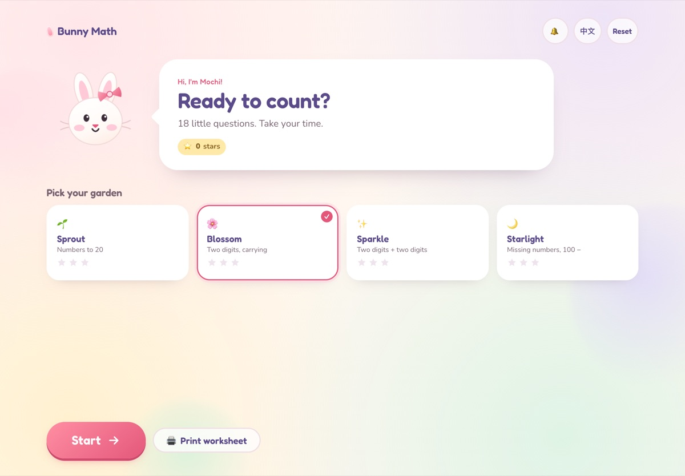
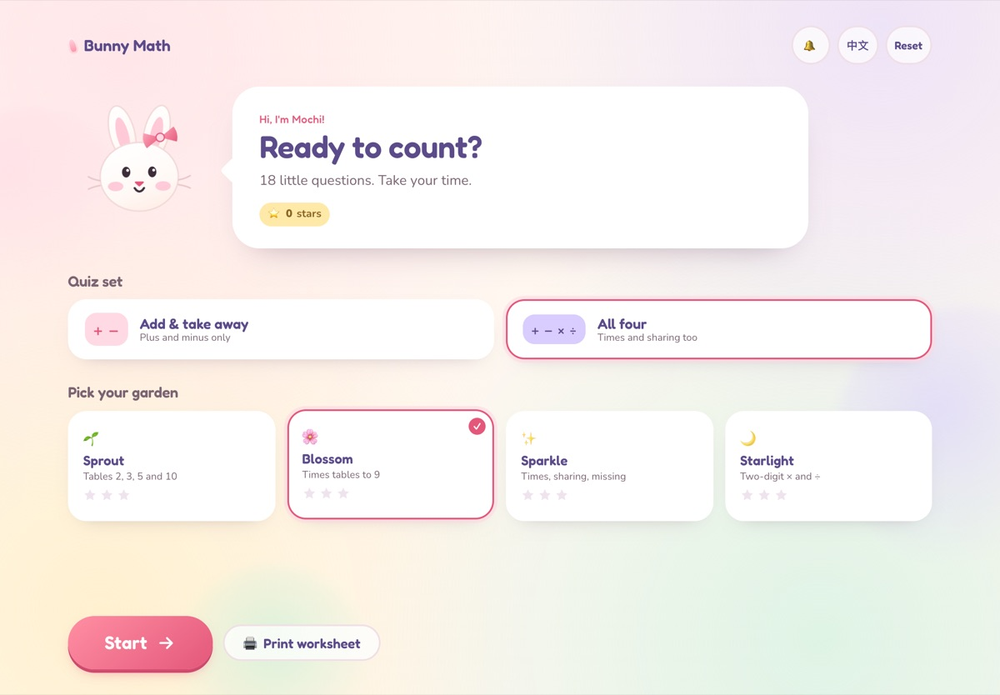
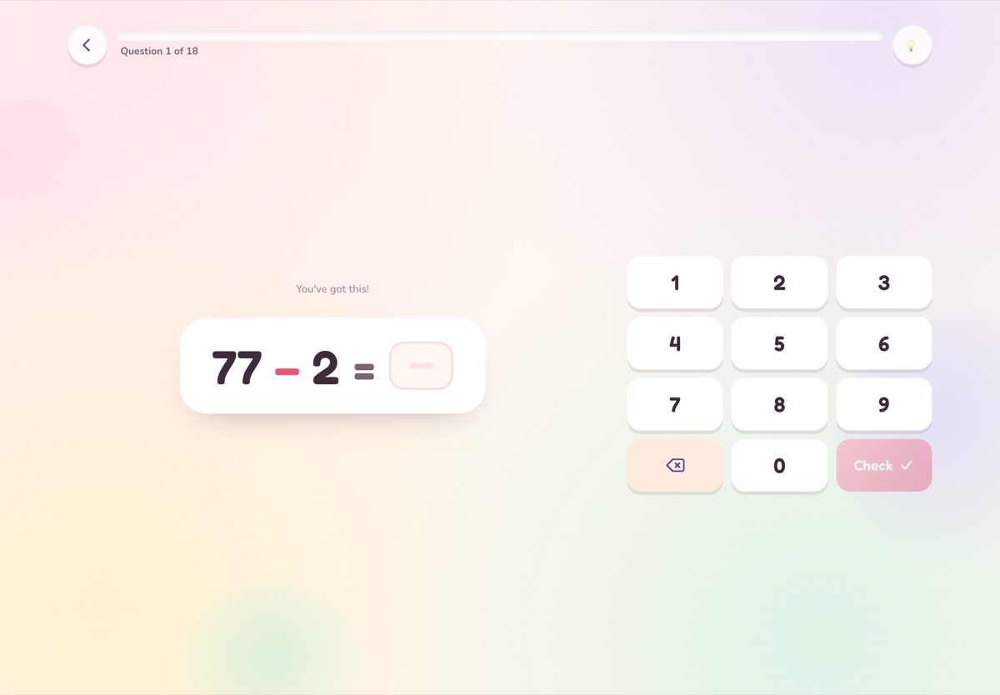
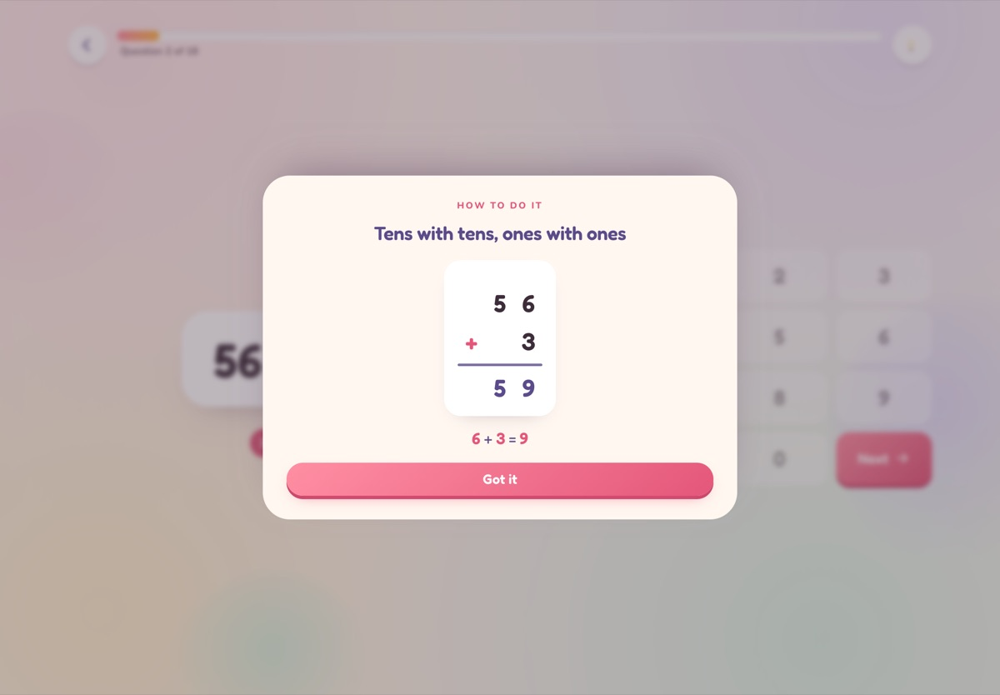
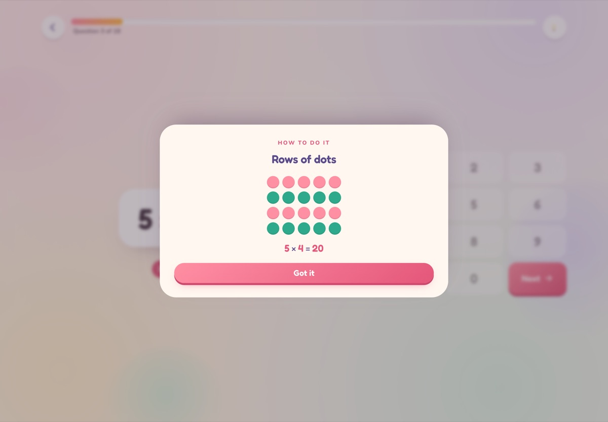
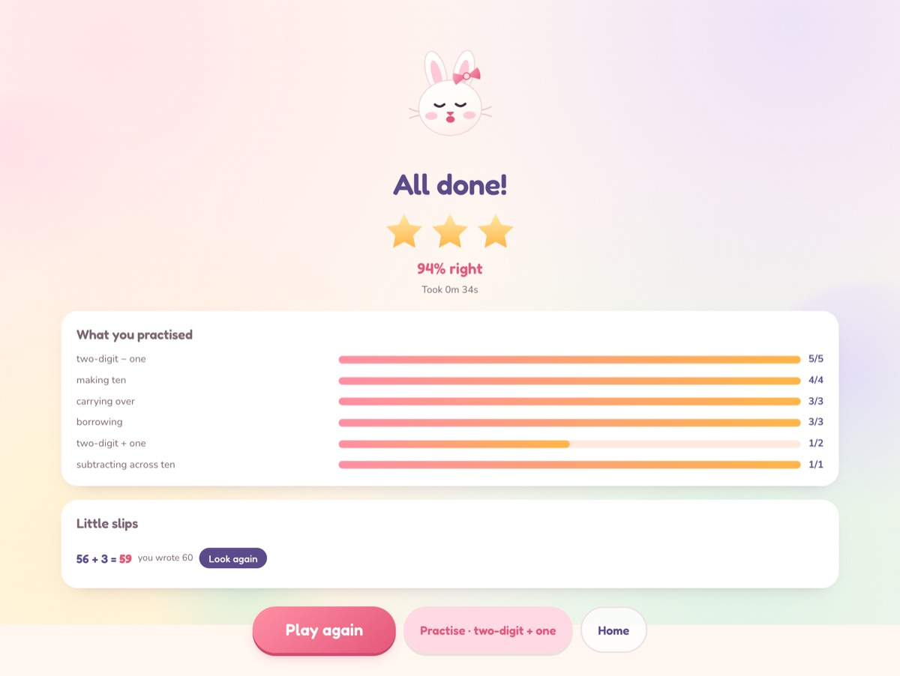
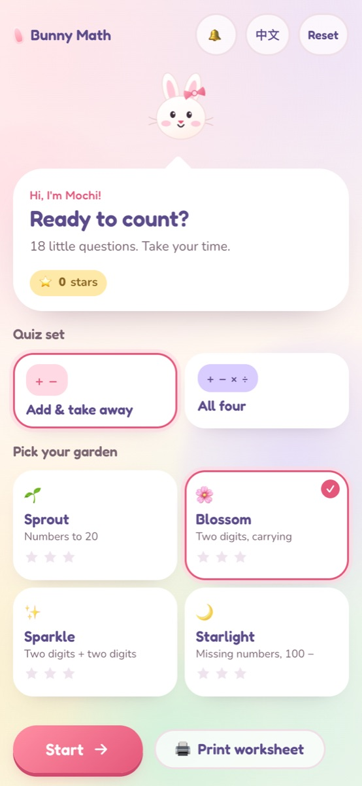
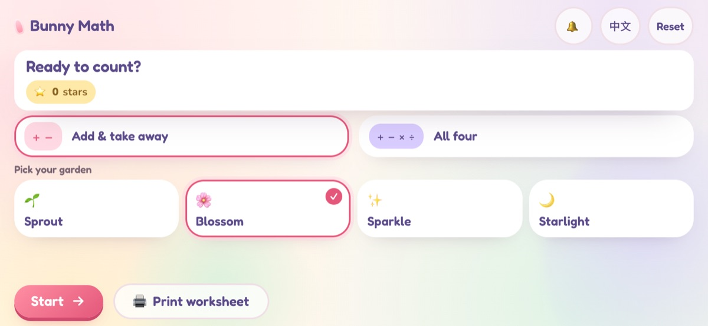
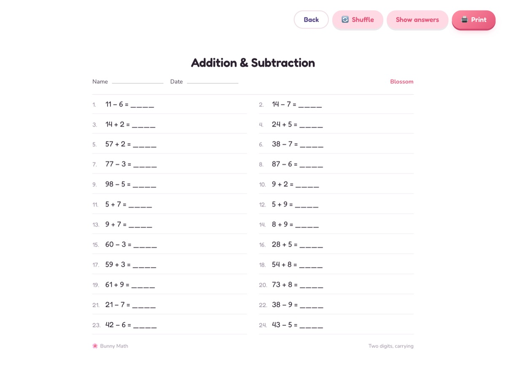
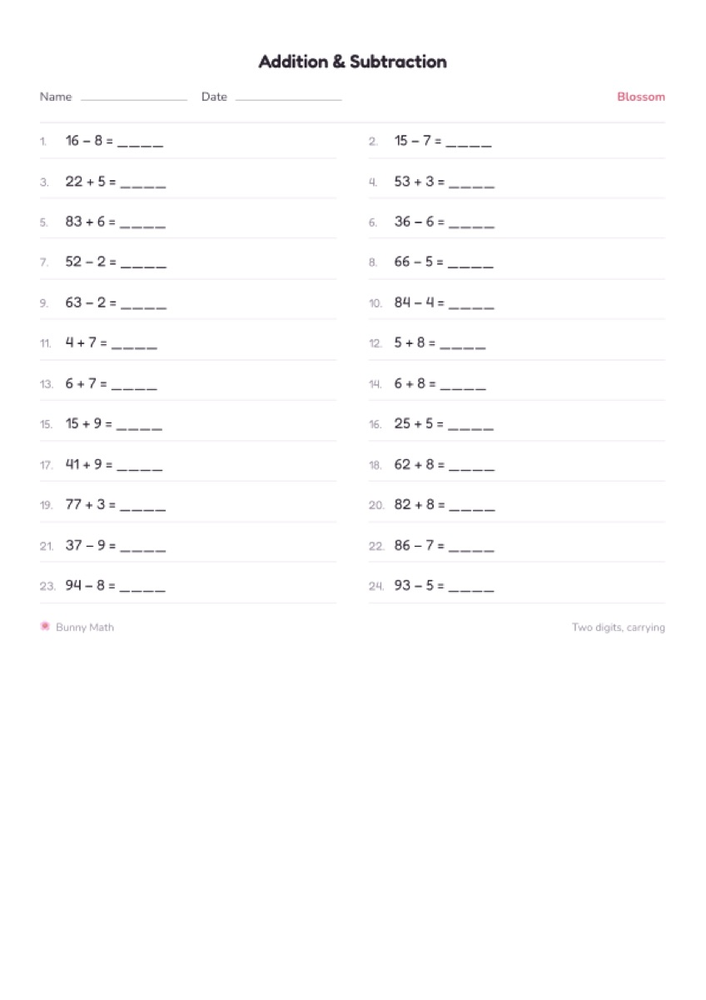

# 🐰 Bunny Learn

[English](README.md) | [中文](README.zh.md)

A **pure front-end** learning site for an 8-year-old: two apps, one repo, one deploy.

| App | URL | What |
| --- | --- | --- |
| 🐰 Bunny Math | `/` | add, subtract, multiply, divide — 18 questions a round |
| 🐰 Bunny English | `/english/` | PEP textbook vocabulary, phonics and grammar — 12 questions a lesson |

```bash
pnpm install
pnpm dev:math       # math    → http://127.0.0.1:5173
pnpm dev:english    # english → http://127.0.0.1:5174
pnpm build:site     # assemble both apps exactly like CI does
```

Details for the English app (content coverage, review spacing, audio generation)
live in [apps/english/README.md](apps/english/README.md). The rest of this file
is about Bunny Math.

---

## 🐰 Bunny Math (apps/math)

A cute little add, subtract, multiply and divide playground for ~8-year-olds,
built as a **pure front-end** web app. No accounts, no backend, no data leaves
the device.

A round is 18 questions answered on a big friendly keypad. Every round is
generated fresh, ramps from gentle to stretchy, and ends with a star rating, a
per-skill breakdown, and a picture-first explanation for anything that slipped.



With *All four* chosen, the same four gardens get times and division:



| Quiz | Explanation |
| --- | --- |
|  |  |

A times-table help panel stays a picture, not a paragraph:





## What's inside

- **Two quiz sets.** Pick *Add & take away* for `+ −` only, or *All four* to
  mix in `× ÷` as well. The garden ladder stays the same, so a Sprout child
  meets 2·3·5·10 tables, not 7 × 8.
- **Generated, not canned.** Every round is drawn from 22 skill generators and
  ordered by an explainable difficulty model, so practice never runs out.
- **Four gardens** (levels), each with its own skill mix and difficulty floor:
  `Sprout` (within 20) → `Blossom` (two digits, carrying) → `Sparkle`
  (two digits ± two digits) → `Starlight` (missing numbers, 100 −). In *All
  four* each garden adds its own times/division skills, up to two-digit × and ÷.
- **Times and sharing.** Times-table questions are always whole-number facts
  (no remainders), and the help panel draws a dot array — *4 rows of 5* — or
  splits the dividend into divisor and quotient.
- **Duolingo-style loop.** Progress bar, instant feedback, streak cheer,
  auto-advance on a correct answer, no timer and no lives.
- **Picture-first help.** A wrong answer offers "Show me", which opens one
  small visual: ten-frame, number-line hops, part-part-whole, or a column sum
  with a carry/borrow badge. One idea per panel, no paragraphs.
- **End-of-round summary.** Stars, accuracy, time, per-skill bars, the slips
  worth another look (each opens its explanation), and a 5-question practice
  round on the weakest skill.
- **Printable worksheet.** The original ask, still supported: 24 questions,
  sorted easy → hard, name/date lines, optional answer key, print-ready A4.
- **English and 中文** with a one-tap switch, plus a sound toggle.
- **Installable PWA** and works offline after the first visit.
- **Landscape tablets, phones, and iPad** — the quiz switches to a
  question-left / keypad-right layout on wide screens and compacts in phone
  landscape.

| Phone | Landscape phone | Worksheet |
| --- | --- | --- |
|  |  |  |

The worksheet prints as a clean two-column A4 page:



## Run it

```bash
pnpm install
pnpm dev:math     # http://127.0.0.1:5173
```

Build and preview the production bundle:

```bash
pnpm --filter @bunny/math build        # typecheck + vite build + service worker
pnpm --filter @bunny/math preview
```

## Test it

```bash
pnpm test         # 25 unit tests: difficulty model + generator invariants
pnpm e2e          # 4 Playwright flows against your installed Chrome
```

E2E uses `channel: 'chrome'`, so there is no 150 MB browser download and the
tests run on the same engine the kid will use.

## Deploy to GitHub Pages

1. Push this repo to GitHub (default branch `main`).
2. **Settings → Pages → Source: GitHub Actions**. Do *not* pick
   "Deploy from a branch": that publishes the raw repository, the browser then
   tries to execute `src/main.tsx`, and the page stays blank.
3. The workflow in `.github/workflows/deploy.yml` runs the unit tests, builds
   with the right base path, and publishes `dist` on every push.

The base path is read from `VITE_BASE` and the workflow picks it automatically:
`/` for a user/org site repository (`<name>.github.io`), `/<repo>/` for a normal
project repository, `/` locally.

## How the difficulty works

`src/game/difficulty.ts` scores every item 0–100 from properties a teacher
would name — magnitude, regrouping, bridging ten, blank position — rather than
from a hand-tuned table:

| Item | Score |
| --- | --- |
| `4 + 5` | 12 |
| `34 + 5` | 32 |
| `28 + 7` (carry) | 48 |
| `15 − 8` (break ten) | 30 |
| `100 − 37` | 84 |
| `5 × 5` | 30 |
| `7 × 8` (hard pair) | 48 |
| `23 × 3` (two-digit) | 64 |
| `56 ÷ 8` | 54 |

`src/game/generator.ts` then builds each round as a ramp: a per-slot difficulty
target, a weighted skill choice, and a scoring pass over candidates that also
penalises repeats (same fact, same skill three times in a row, same answer
twice). Each level declares a difficulty floor, so a warm-up is gentle but not
babyish. The ordering guarantees — inside a family, across levels, and across a
round — are pinned by tests instead of by trusting the constants.

Times and division get their own branch: which table the fact is from, how hard
the pair is (`6 × 7` and `8 × 9` cost more than `2 × 4`), a small penalty for
division, and the usual +20 when the blank moves. Every `÷` is generated as
`divisor × quotient`, so `accept()` can reject anything with a remainder —
remainders are a different lesson.

## Layout

```
apps/
  math/      the math app  →  /
    src/game/       difficulty, skills, levels, generator, session, scoring, rng
    src/components/ Home, Quiz, Equation, Keypad, Strategy, Result, PrintSheet…
    src/i18n/       hand-rolled en/zh dictionary
    src/lib/        localStorage progress, WebAudio chirps
    src/styles/     one hand-written CSS file with design tokens
    e2e/            Playwright flows
  english/   the English app  →  /english/   (see apps/english/README.md)
scripts/     workspace tools: build-site (CI parity), icons, screenshots
docs/        screenshots used by the READMEs
```

## Privacy

Nothing is collected and nothing is sent anywhere. Progress (level, stars,
streak, best scores) lives in `localStorage` under `bunnymath.v1` and can be
cleared from the home screen.
