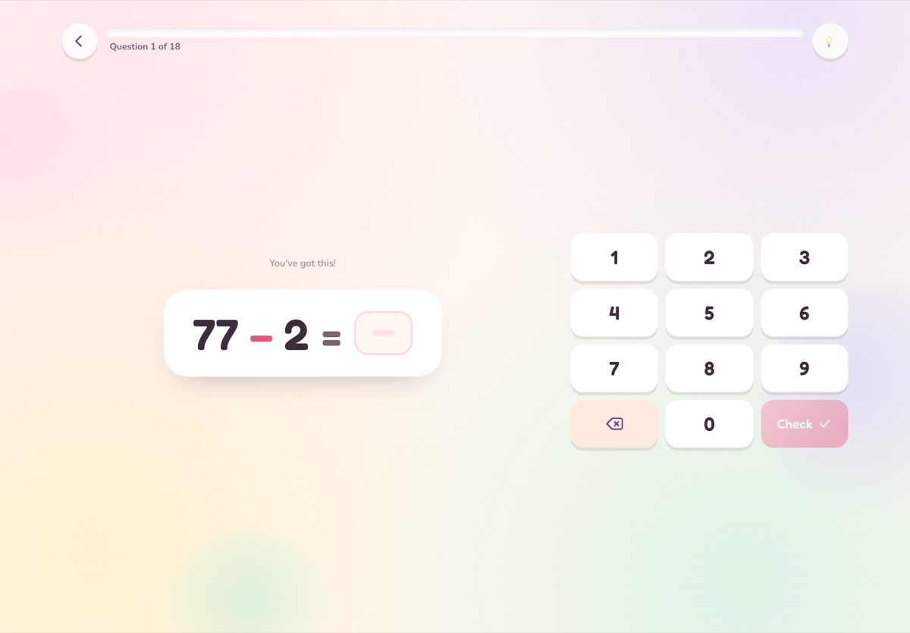
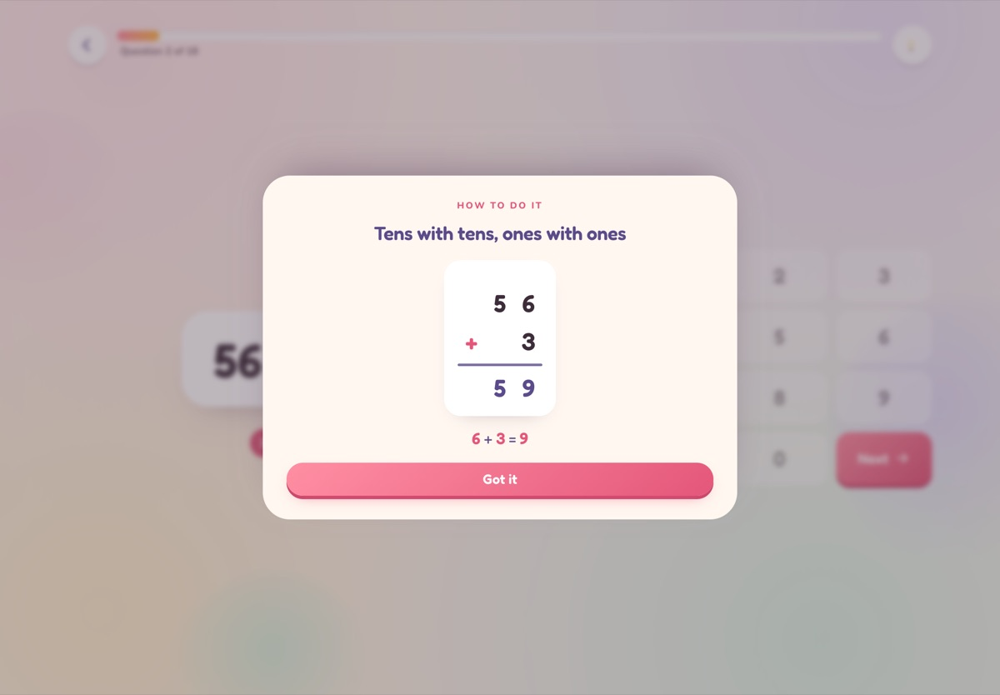
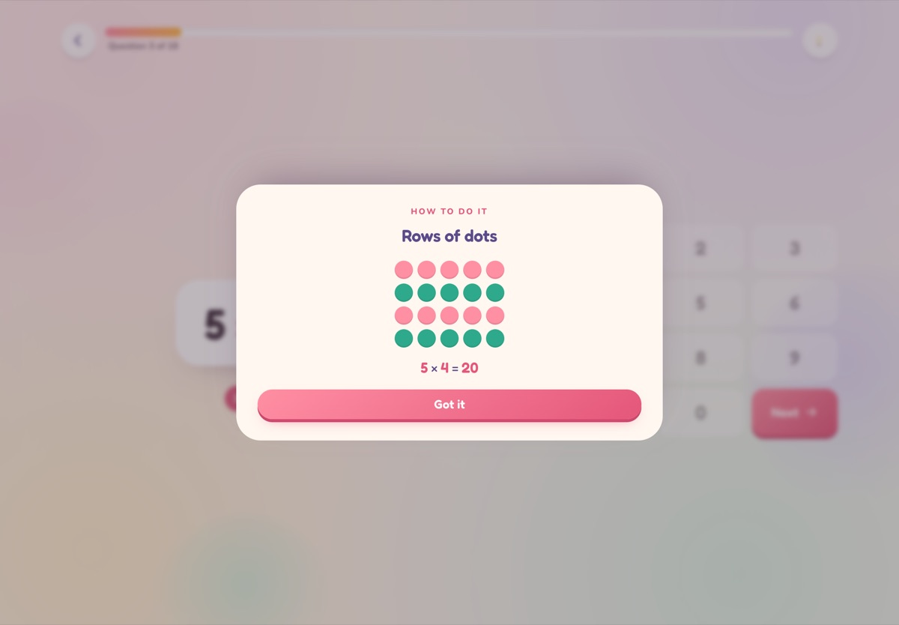
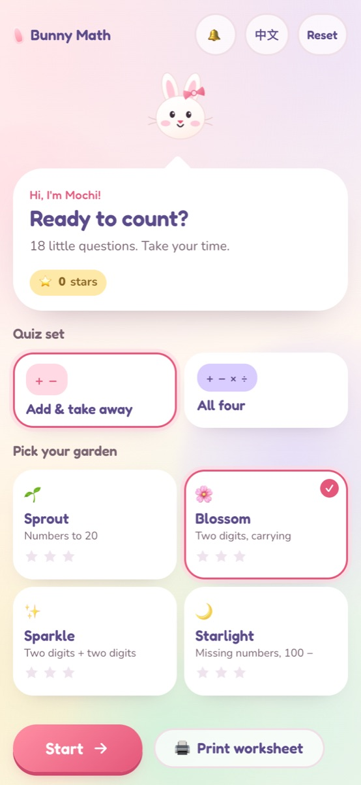
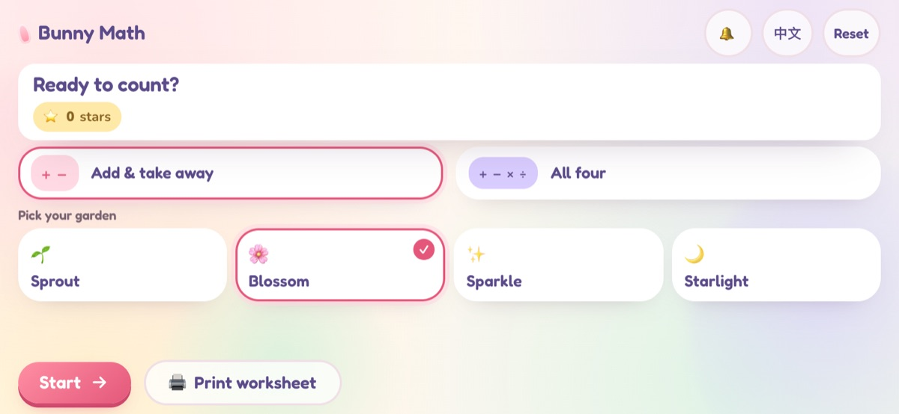
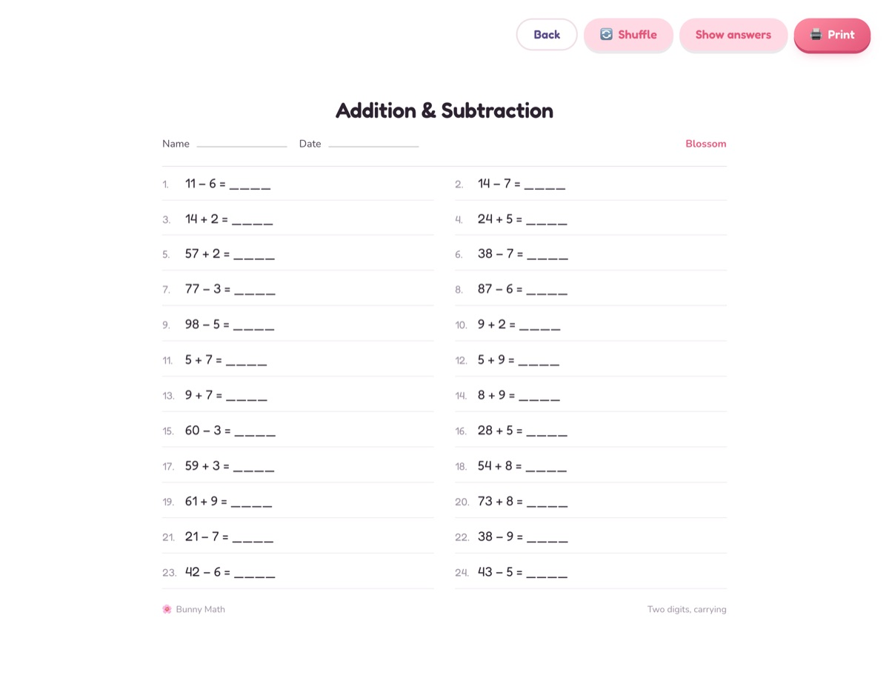
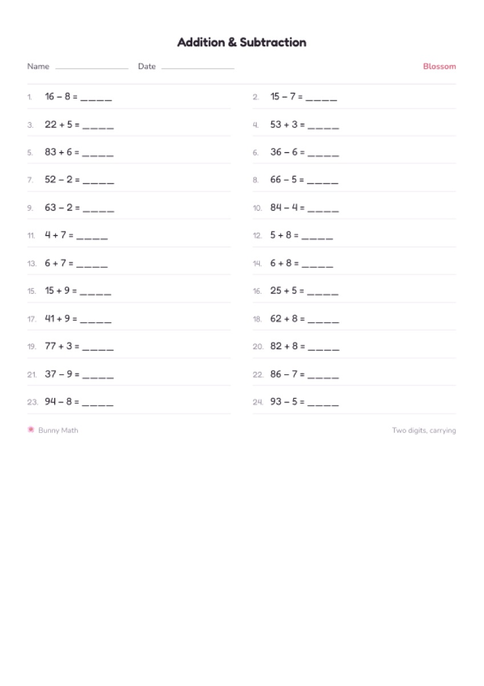

# 🐰 小兔数学 (Bunny Math)

[English](README.md) | **中文**

给 8 岁左右小朋友的加减乘除练习小游戏，**纯前端**，没有账号、没有后端，数据不出设备。

一局 18 题，用一块大大的数字键盘作答。每局都是现场生成的，难度从轻松慢慢过渡到有挑战；结束后给出星星评级、每类技能的正确率，答错的题还能看一张图就懂的讲解。


选「加减乘除」，同样的四个花园会加上乘法和除法：


| 答题 | 讲解 |
| --- | --- |
|  |  |

乘法表的讲解同样是一张图，不是一段话：




## 都有什么

- **两个题组。** 首页可选「只做加减」（只有 `+ −`）或「加减乘除」（再加 `× ÷`）。难度花园不变，所以小芽档遇到的是 2、3、5、10 的乘法，而不是 7 × 8。
- **题目是生成的，不是题库。** 22 个技能生成器 + 一套可解释的难度模型，每局重新排列组合，永远刷不完。
- **四个花园（难度档）**，各有自己的技能组合和难度下限：
  `小芽 / Sprout`（20 以内）→ `小花 / Blossom`（两位数、进位）→
  `星光 / Sparkle`（两位数 ± 两位数）→ `月光 / Starlight`（填空、100 −）。
  在「加减乘除」题组里，每档还会加上对应的乘除技能，最高到两位数乘除。
- **乘法与平均分。** 乘法题都是整句乘法表里的整句（除法不带余数）；讲解面板会画「一排排的点」，或者把被除数拆成除数和商。
- **类 Duolingo 的节奏。** 进度条、即时反馈、连对加油、答对自动进入下一题；不设倒计时，也没有生命值。
- **看图讲解。** 答错后点「看看怎么做」，只弹一张小图：十格阵、数轴跳格、部分-整体、带进/退位标记的竖式。一屏只讲一个点，没有大段文字。
- **结算页。** 星星、正确率、用时、每类技能的正确率横条、值得再看一眼的错题（点开就是讲解），以及针对最弱技能生成的 5 题加练。
- **可打印练习纸。** 最初的需求也没丢：24 题、按难度从易到难排好、有姓名日期栏、可选答案页，A4 直接打印。
- **中英文一键切换**，另有音效开关。
- **可安装的 PWA**，首次打开后离线也能玩。
- **横屏平板、手机、iPad 都适配** —— 宽屏时自动变成「左边题目、右边键盘」，手机横屏则整体紧凑排布。

| 手机 | 手机横屏 | 练习纸 |
| --- | --- | --- |
|  |  |  |

打印出来是一张干净的两栏 A4：



## 运行

```bash
pnpm install
pnpm dev          # http://localhost:5173
```

打包并预览生产版本：

```bash
pnpm build        # 类型检查 + vite 打包 + 生成 Service Worker
pnpm preview
```

## 测试

```bash
pnpm test         # 25 个单元测试：难度模型 + 出题器的各项不变量
pnpm e2e          # 4 条 Playwright 流程，直接驱动本机 Chrome
```

E2E 用 `channel: 'chrome'`，不下载 150 MB 的浏览器内核，跑的就是孩子平常用的那个引擎。

## 发布到 GitHub Pages

1. 把仓库推到 GitHub（默认分支 `main`）。
2. **Settings → Pages → Source 选 GitHub Actions**（不要选 "Deploy from a branch"，否则发布的是源码，会白屏）。
3. 之后每次 push，`.github/workflows/deploy.yml` 会先跑单元测试，再以正确的 base 路径打包并发布 `dist`。

base 路径由 `VITE_BASE` 决定，工作流会自动区分：

- 用户/组织站点仓库（`<名字>.github.io`）→ `/`
- 普通项目仓库 → `/<仓库名>/`
- 本地 → `/`

## 难度是怎么算的

`src/game/difficulty.ts` 按老师会说的那些特征给每道题打 0–100 分——数的大小、是否需要进位/退位、是否凑十、空格在第几个位置——而不是靠一张手工调的对照表：

| 题目 | 分数 |
| --- | --- |
| `4 + 5` | 12 |
| `34 + 5` | 32 |
| `28 + 7`（进位） | 48 |
| `15 − 8`（破十） | 30 |
| `100 − 37` | 84 |
| `5 × 5` | 30 |
| `7 × 8`（难的一对） | 48 |
| `23 × 3`（两位数） | 64 |
| `56 ÷ 8` | 54 |

`src/game/generator.ts` 再把一局组织成一条坡度：每个位置有一个目标难度，按权重挑技能，对候选题目打分，同时惩罚重复（同一道题、连续三题同一技能、同一个答案出现两次）。每个难度档都声明了一个下限，保证热身题简单但不幼稚。这些顺序上的保证——技能内部、档位之间、以及一局之内——都由测试锁住，而不是靠调参数的手感。

乘除走的是另一支：看这个算式属于哪张乘法表、这一对因数难不难（`6 × 7`、`8 × 9` 比 `2 × 4` 分值高）、除法加一点分，空格换位置照旧 +20。所有 `÷` 都按 `除数 × 商` 生成，`accept()` 因此能拒掉任何带余数的题——余数是另一课。

## 目录结构

```
src/
  game/      纯 TypeScript：难度、技能、档位、出题器、状态机、统计、随机数
  components/ Home、Quiz、Equation、Keypad、Strategy、Result、PrintSheet、Mascot、Stars……
  i18n/      手写的 en/zh 词典（没有引入 i18n 库）
  lib/       localStorage 进度、WebAudio 音效
  styles/    一个手写的、带设计 token 的 CSS 文件
scripts/     截图与图标脚本（用本机 Chrome，不依赖图像库）
e2e/         Playwright 流程测试
```

## 隐私

不收集、不上传任何数据。进度（档位、星星、连续天数、最好成绩）存在 `localStorage` 的 `bunnymath.v1` 里，首页可以一键清除。
