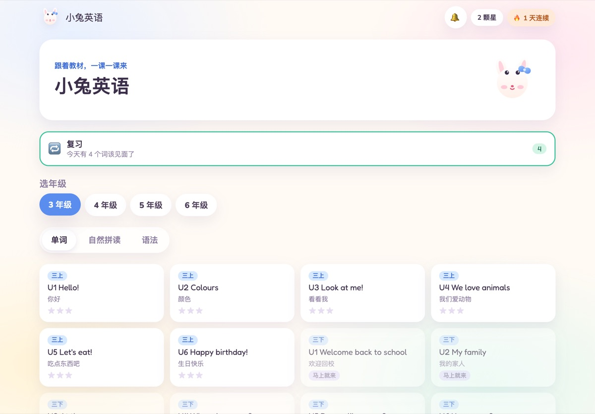
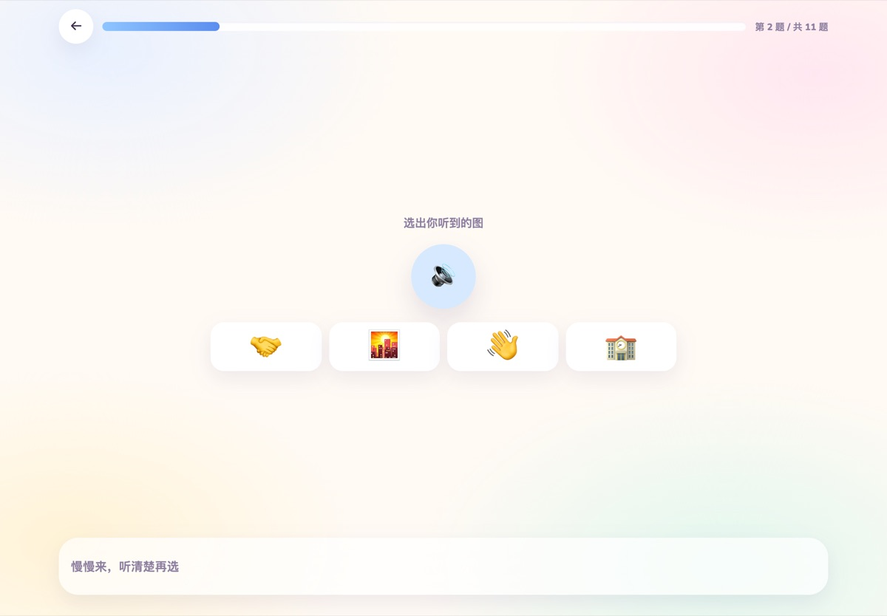
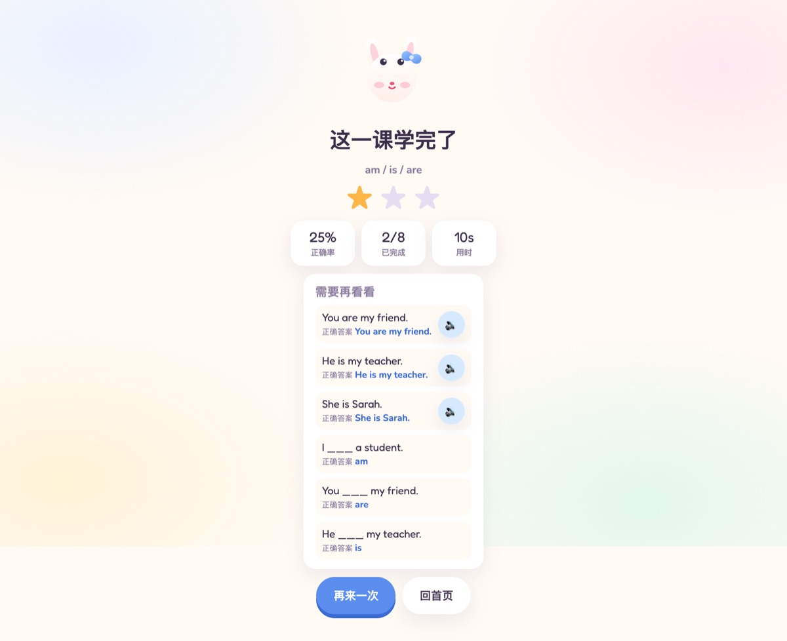
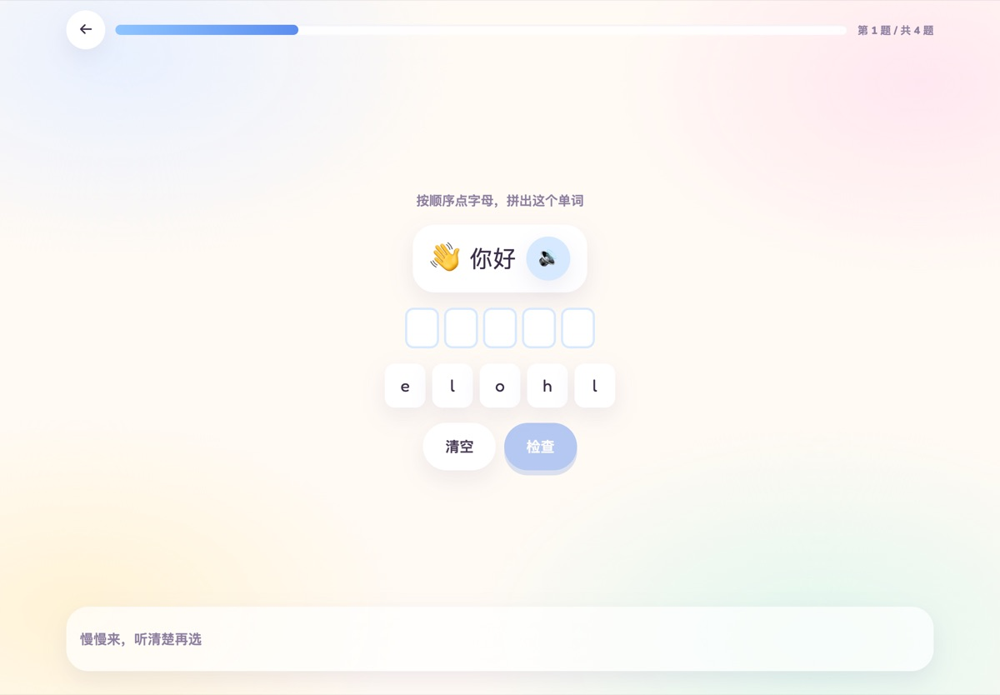

# 🐰 小兔英语 (Bunny English)

给中文母语的小朋友练英语的小应用，跟着**人教版 PEP（三年级起点）**的单元走。
纯前端：没有账号、没有后端，进度只存在这台设备的 `localStorage` 里。



## 它怎么用

首页先选**年级**（3–6），再选**内容**：

| 菜单 | 内容 | 来源 |
| --- | --- | --- |
| 单词 | 每册 6 个单元的词汇 + 例句 | PEP 单元表 |
| 自然拼读 | 短元音、magic-e、ar/or、ou/ow 等音组 | 自编音组表，按年级分 |
| 语法 | be 动词、this/these、there is、过去式、比较级… | 自编句型，按年级分 |

| 听音选图 | 错题回看 |
| --- | --- |
|  |  |

每课固定 12 题，全部点选，不用打字：

- **看图选词**：给一张 emoji，选出英文
- **听音选图**：只听声音，选出对应的图（图下不显示英文，否则就变成阅读题了）
- **拼单词**：给打乱的字母块，按顺序拼出来
- **中英互选**：中文 → 英文、英文 → 中文各一题
- **连一连**：左右两列配对
- **组句**：把词块排成一句话
- **填空**：`I ___ a student.` 选 am / is / are

点击课程或「开始学习」默认进行普通课程练习。每课另有「趣味小闯关」，复用当前课程题型，单独显示闯关进度与当轮星光；学习模式只显示练习进度。首页收藏默认折叠，学习内容优先展示。

完成一轮练习获得 1 颗努力星，每个当轮首次答对的题目再得 1 颗。英语和古诗共用星光收藏：星星 → 月亮 → 太阳 → 星系 → 宇宙，每满 10 个合成下一级，宇宙继续累计；复习和重复闯关也能积累，答错不扣星，中途离开不结算。旧星数在首次进入对应学科时导入一次，原有课程记录不变。收藏保存在同一站点、同一浏览器的 `bunny-star-collection.v1` 中，扩展等级不改变已保存的终身星数。

结算展示本次星光收获和合成进度，不显示正确率或用时；保留**「需要再看看」**清单：
每道错题列出题干、你写的答案（划掉）和正确答案，还有一个小喇叭可以直接听。

## 复习：隔天再见面

每道题答完都会记一条记忆（`w:<英文>` 或 `s:<句子>`）：

- 答对：等级 +1，下次间隔按 **1 → 3 → 7 → 16 天** 递增
- 答错：等级 −1（最低 0），明天再来

| 复习入口 | 复习一轮 |
| --- | --- |
|  |  |

首页顶部的「复习」卡片显示今天到期的数量，点进去就是一轮混合练习。
列表为空时卡片是灰的，不会打扰小朋友。

## 内容范围

单元表覆盖 PEP 三上到六下共 **46 个单元**（六下只有 4 个单元，其余七册各 6 个），
**全部填好**：473 条词条、497 个不同拼写，每个词都有 emoji 和一句例句。

| 册 | 单元 | 词 |
| --- | --- | --- |
| 三上 / 三下 | 12 个单元：问候、颜色、身体、动物、食物、数字… | 133 |
| 四上 / 四下 | 12 个单元：教室、书包、朋友、家、学校、时间、天气、农场、衣服、购物… | 120 |
| 五上 / 五下 | 12 个单元：性格、一周、食物、能力、房间、自然公园、作息、季节、月份、物主代词… | 120 |
| 六上 / 六下 | 10 个单元：问路、交通、计划、爱好、职业、情绪、比较级、过去时… | 100 |

想加或改内容，只需要往 `src/content/pep.ts` 的 `WORD_BANK` 里补
`w(id, en, zh, emoji, sentence)`，再跑一次 `node scripts/gen-audio.mjs` 补音频，界面会自动出现。

## 听力和发音

`public/audio/words/<slug>.mp3` 和 `public/audio/sentences/<slug>.mp3` 是**预生成**的音频，
用 `edge-tts` 的 `en-US-AnaNeural`（童声）生成，语速 `-10%`。
目前一共 **999 个文件**（497 个单词 + 502 个句子），约 15 MB，每个文件约 11 KB / 2 秒。

```bash
cd apps/english
python3 -m venv .ttsenv
./.ttsenv/bin/pip install edge-tts
node scripts/gen-audio.mjs                  # 缺什么补什么，可以反复跑
VOICE=en-US-EmmaNeural RATE=-5% node scripts/gen-audio.mjs   # 换个声音重来
```

换声音时先删掉要重生成的 mp3（脚本会跳过已存在的文件）。
没有音频文件时会回退到浏览器的 `speechSynthesis`，并优先挑一个英文语音；
但网页语音在不同设备上差别很大，所以正式使用建议把 mp3 都生成好再部署。

**自动播放不会用系统语音。** iOS/Safari 在第一次手势之前会拦掉 `play()`，
如果这时回退到系统语音，孩子随后点小喇叭播放 mp3，就会出现「童声 + 成人声」同时响。
所以自动播放失败就保持安静，系统语音只在手动点击、且确实没有 mp3 时才用。

## 本地运行

```bash
pnpm install
pnpm dev:english      # http://127.0.0.1:5174
```

```bash
pnpm --filter @bunny/english test      # 内容完整性 + 出题 + 复习调度
pnpm --filter @bunny/english exec tsc --noEmit
```

## 部署

和数学应用一起发布到同一个 GitHub Pages 站点：

- 数学在 `/`
- 英语在 `/english/`

`pnpm build:site` 会在本地把两个应用拼进 `site/`（和 CI 做的事一样）。
英语应用自己的 Service Worker 注册在 `/english/` 作用域，数学应用的那个加了
`navigateFallbackDenylist: [/^\/english\//]`，所以两边不会互相抢路由。
